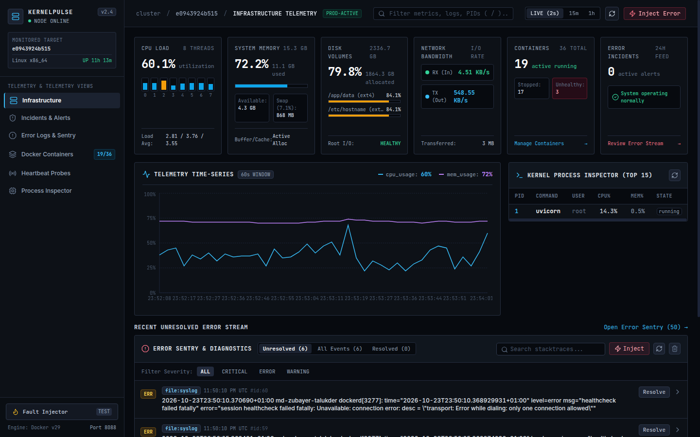
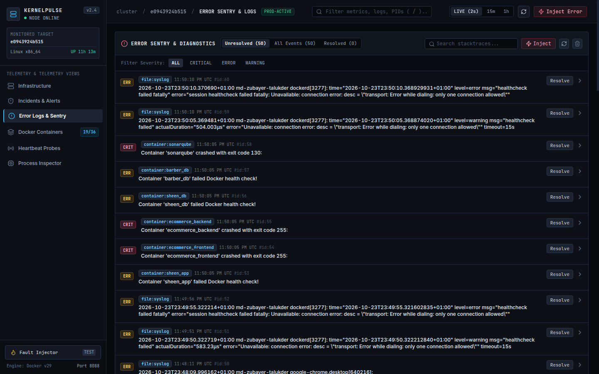
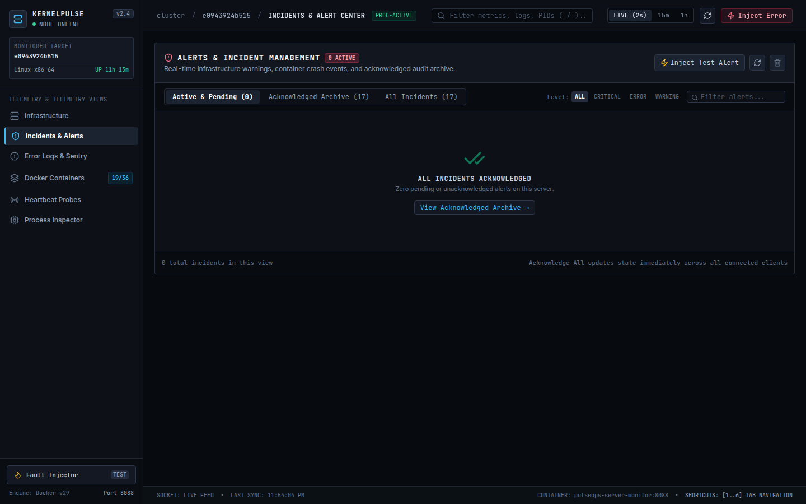
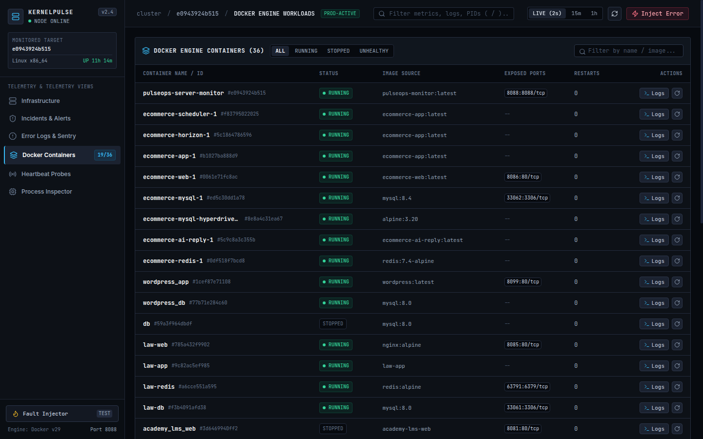

# monetor-your-server

[](https://www.docker.com/)
[](https://fastapi.tiangolo.com/)
[](https://react.dev/)
[](https://tailwindcss.com/)
[](LICENSE)

> **A modern, lightweight, full-stack Server & Container Error Monitoring platform.**  
> Monitor server health, tail system and container error logs in real-time, inspect crash stacktraces, and manage incident alerts — all fully Dockerized with zero external cloud dependencies.

---

## 📸 Screenshots

### 1. Infrastructure Telemetry Overview
*Real-time per-core CPU meters (htop style), memory allocation rails, disk mountpoints, network transfer rates, and Grafana-style time-series charts.*


---

### 2. Sentry-Style Server Error Diagnostics
*Automatic error detection from `/var/log/syslog`, Nginx error logs, and container `stderr`. Inspect full stacktraces with syntax frames and 1-click trace copying.*


---

### 3. Incidents & Alert Management (With Bulk Acknowledge)
*Dedicated separate page to triage active incidents, review crash warnings, and resolve all alerts with a single click.*


---

### 4. Docker Workloads Console
*Discovers and tracks all Docker containers running on the host via `/var/run/docker.sock`. Live container terminal log streamer and restart controls.*


---

## 💡 What is This Project?

When running production or development servers, applications crash, memory fills up, databases exhaust connection pools, and containers exit unexpectedly.

Most traditional monitoring solutions are either:
- **Too heavy & complex**: Setting up Prometheus + Grafana + Loki + Promtail + Alertmanager requires massive memory and dozens of configuration files.
- **Expensive SaaS**: Datadog, New Relic, and Sentry charge high monthly bills and require sending your server data to third-party clouds.

**`monetor-your-server` (PulseOps)** solves this by giving you a **self-hosted, single-container, full-stack monitoring system** with a sleek Datadog/Sentry-style UI that starts with a single command:
```bash
docker compose up -d
```

---

## ⚙️ How It Works

The platform operates across 3 simple layers:

```
┌─────────────────────────────────────────────────────────────┐
│                     Host Linux Server                       │
│     /proc (metrics)   /var/run/docker.sock   /var/log       │
└──────────────────────────────┬──────────────────────────────┘
                               │ Mounted Volume Pipes (:ro)
┌──────────────────────────────▼──────────────────────────────┐
│             PulseOps Container Engine (:8088)               │
│                                                             │
│  1. System Collector     Reads CPU per-core, RAM, Disk, IO │
│  2. Docker Daemon Reader Discovers containers, health & logs│
│  3. Log Sentinel         Tails syslog, nginx & stderr       │
│  4. Service Prober       Pings HTTP/TCP ports (3306, etc.)  │
│  5. Alert Evaluator      Triggers thresholds & incidents    │
└──────────────────────────────┬──────────────────────────────┘
                               │ WebSocket Feed (2s tick)
┌──────────────────────────────▼──────────────────────────────┐
│               Modern Frontend Workstation                   │
│          (React 18 + Tailwind CSS + JetBrains Mono)         │
└─────────────────────────────────────────────────────────────┘
```

1. **Host Probing & Log Collection**:
   - The container mounts `/var/run/docker.sock`, `/proc`, and `/var/log` in read-only mode (`:ro`).
   - The Python backend periodically polls host metrics (CPU, RAM, swap, disk, network bandwidth) using `psutil`.
   - A background worker tails `/var/log/syslog`, `/var/log/nginx/error.log`, and container `stderr` streams, detecting exceptions (OOM killer, segmentation faults, HTTP 500s, DB timeouts).

2. **Telemetry Streaming**:
   - FastAPI streams telemetry snapshots over WebSockets (`/ws/telemetry`) every 2 seconds.
   - Any metric spike or error is stored in a local SQLite database (`servermon.db`).

3. **High-Density User Interface**:
   - The React frontend provides instant real-time visualization with zero page reloads.
   - Includes dedicated separate pages for Infrastructure, Incidents & Alerts, Error Logs, Docker Workloads, Heartbeat Probes, and Process Inspector.

---

## 🌟 Key Benefits

| Benefit | Description |
|---|---|
| 🐳 **100% Dockerized** | Single multi-stage container. No manual Node.js or Python setup required. |
| 🚨 **Server Error Catching** | Captures real errors from Linux syslog, Nginx, and container stderr streams in real-time. |
| 🛡️ **Dedicated Incidents Page** | Review active issues, copy stacktraces, and use **"Acknowledge All"** to clear alerts with 1 click. |
| 📊 **htop-Style CPU Heatstrip** | Visualizes individual load across all CPU cores side-by-side. |
| 🐳 **Docker Workload Control** | Inspect health, view live container logs, and restart containers directly from the UI. |
| 🌐 **Uptime Heartbeat Prober** | 30-block visual heartbeat strip for HTTP endpoints and TCP ports (MySQL `3306`, Redis `6379`). |
| ⚡ **Fault Injection Tool** | Built-in "Inject Error" button and CLI tool to test your alerting pipeline anytime. |
| 🔒 **100% Private & Self-Hosted** | Your server logs and data never leave your own server. |

---

## 🚀 Quick Start Guide

### Prerequisites
- Docker Engine 20+
- Docker Compose v2+
- Git

### 1. Clone & Run
```bash
git clone git@github.com:mdzubayertalukder/monetor-your-server.git
cd monetor-your-server

# Launch container stack
docker compose up -d
```

### 2. Access the Web Dashboard
Open your browser and navigate to:
- **Web Dashboard**: [http://localhost:8088](http://localhost:8088)
- **API Swagger Documentation**: [http://localhost:8088/docs](http://localhost:8088/docs)
- **Health Check**: [http://localhost:8088/api/health](http://localhost:8088/api/health)

---

## 🧪 Testing Error Monitoring (Fault Injector)

Verify that real-time error detection and alerts work with our built-in fault simulator:

### Option A: From Web Dashboard
Click the **"Inject Error"** button in the top navigation bar, pick an error preset (e.g. *Kernel OOM Killer*, *MySQL Pool Exhaustion*, *502 Bad Gateway*), and click **Inject Fault**.

### Option B: From Command Line
```bash
# Simulate a Database Connection Failure
python3 scripts/generate_test_errors.py --type db

# Simulate an Out of Memory (OOM Killer) Kernel event
python3 scripts/generate_test_errors.py --type oom

# Simulate an Nginx 502 Bad Gateway
python3 scripts/generate_test_errors.py --type nginx

# Simulate a Container Crash
python3 scripts/generate_test_errors.py --type crash
```

---

## ⌨️ Keyboard Shortcuts

Navigate quickly between telemetry pages:
- <kbd>1</kbd> — Infrastructure Telemetry Dashboard
- <kbd>2</kbd> — Incidents & Alerts Center (with Acknowledge All)
- <kbd>3</kbd> — Error Sentry & Log Stacktraces
- <kbd>4</kbd> — Docker Containers Console
- <kbd>5</kbd> — Heartbeat Uptime Probes
- <kbd>6</kbd> — Kernel Process Inspector

---

## 📁 Repository Structure

```
.
├── docker-compose.yml              # Production Docker Compose orchestration
├── Dockerfile                      # Multi-stage production container build
├── .env.example                    # Environment settings template
├── start.sh                        # Fast startup script
├── README.md                       # Documentation
├── docs/
│   └── images/                     # Dashboard & Sentry screenshots
│       ├── dashboard.png
│       ├── incidents.png
│       ├── error_sentry.png
│       └── containers.png
├── backend/
│   ├── requirements.txt            # Python dependencies (FastAPI, psutil, docker)
│   └── app/
│       ├── main.py                 # FastAPI application & background workers
│       ├── config.py               # Environment variables
│       ├── storage/database.py     # SQLite persistence layer
│       ├── collectors/             # System, Docker, Log & Service checkers
│       ├── alerts/                 # Threshold & notification dispatchers
│       └── routes/                 # REST API endpoints & WebSockets
├── frontend/
│   ├── package.json
│   ├── vite.config.js
│   ├── tailwind.config.js
│   └── src/
│       ├── App.jsx                 # Stateful dashboard application
│       └── components/             # High-density UI components
└── scripts/
    └── generate_test_errors.py     # CLI fault injection simulator
```

---

## 📄 License

This project is open-source and available under the [MIT License](LICENSE).
